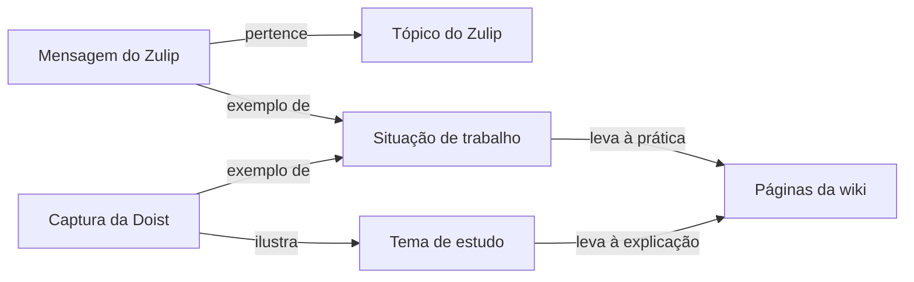

# Explorar o grafo da coleta

O [índice](index.md) reúne as páginas de estudo. Na [edição local](local/index.md), uma mensagem pode estar ligada ao tópico do Zulip, a uma situação como negociação de prazo e a um tema como gramática. A edição de curadoria do repositório inclui as transcrições da Doist e as referências de origem. Na máquina da coleta também há imagens para conferência visual.



## Usar a edição pronta

Abra o [índice](index.md) na pasta `wiki/` do projeto. Para consultar o grafo SQLite pelo terminal, execute os comandos abaixo nessa pasta.

```powershell
python -B -X utf8 construir_grafo.py resumo
python -B -X utf8 construir_grafo.py buscar --situacao se-apresentar --curados --formato markdown
python -B -X utf8 construir_grafo.py buscar --situacao negociar-prazo --fonte Doist --limite 10
python -B -X utf8 construir_grafo.py buscar --tema phrasal-verbs --texto "get back"
python -B -X utf8 construir_grafo.py mostrar zulip-msg-2552913
python -B -X utf8 ingerir_acervo.py --verificar
```

Os resultados trazem o ID, a página dentro da wiki e a URL de procedência. Use `mostrar` para ver o texto e as ligações de um item, ou `--pular 10` para navegar à página seguinte de uma busca com dez resultados.

O índice usa três relações. `pertence` leva a mensagem ao tópico. `candidato` registra a expressão que acionou uma regra de classificação. `curado` liga às situações e aos temas um exemplo conferido nas páginas. O YAML usa `learning_uses` para indicar usos pedagógicos da interação. Em tópicos do Zulip, `learning_by_message` acrescenta os usos de mensagens específicas e `message_learning_default` indica `leitura-contextual` para as demais. Em [pronúncia](pronuncia.md), a transcrição e os exercícios estão na página. Os links para áudio são opcionais.

## Decisões por ID

A busca `search_wiki` consulta o texto das páginas e os vínculos do grafo. Use `kind`, `source`, `topic`, `situation`, `text`, `function` e `curation` para selecionar resultados. Com `curation: conferido`, confira a função e o trecho em `evidencias`. Abra `citar_id` com `read_wiki_item` e use `offset_texto` quando o trecho estiver adiante no texto. Um anexo indica as mensagens de origem na lista `origens`. A fonte `Projeto` identifica os guias e as adaptações escritos para o estudo.

| Situação | Exemplos por função |
| --- | --- |
| Pedir atualização | [Perguntar pelo andamento](local/zulip/canal-137/zulip-topico-8d11987ce5198a1a3dcbe657.md#zulip-msg-1021504) · [combinar quando confirmar](local/doist/doist-pedir-atualizacao.md) |
| Negociar prazo | [Pedir mais tempo](local/zulip/canal-127/zulip-topico-617d08ae9ea45953393575c8.md#zulip-msg-413776) · [propor outra data](local/doist/doist-combinar-prazo.md) · [recusar o prazo](local/zulip/canal-9/zulip-topico-525ecba640cdf78698db13bf.md#zulip-msg-1236079) · [confirmar a extensão](local/zulip/canal-127/zulip-topico-617d08ae9ea45953393575c8.md#zulip-msg-413787) |
| Dar feedback | [Pedir uma avaliação](local/doist/doist-dar-feedback.md) · [responder ao comentário](local/zulip/canal-101/zulip-topico-2cf5ae22c069154ba365fc47.md#zulip-msg-1518710) |
| Confirmar próximos passos | [Assumir uma tarefa](local/zulip/canal-378/zulip-topico-c71e9f563b5a009382da8b3e.md#zulip-msg-2499678) · [prometer retorno](local/zulip/canal-137/zulip-topico-32aa081248d947f4eb291f7a.md#zulip-msg-1950081) |
| Apresentar-se | [Apresentar o papel](local/doist/doist-learning-ally-recepcao-voluntarios.md) · [descrever a experiência](local/zulip/canal-2/zulip-topico-2ada5702e199cf63c9129129.md#zulip-msg-2552913) |
| Pedir ajuda | [Pedir orientação](local/anexos/zulip-anexo-0d1d5afcd4c82604931d79ec8832512a.md) · [solicitar um teste](local/zulip/canal-43/zulip-topico-d8db24549f1af78a3ebd3b4a.md#zulip-msg-535380) |
| Esclarecer | [Conferir a interpretação](local/zulip/canal-101/zulip-topico-593360455d5a9540bc2c1502.md#zulip-msg-2535843) · [agradecer o esclarecimento](local/zulip/canal-2/zulip-topico-f012a84d6c18ca4c9dd73ea2.md#zulip-msg-1067549) |
| Comunicar risco | [Explicar a condição de risco](local/zulip/canal-3/zulip-topico-3bddea53f8ad3a38257c0a0a.md#zulip-msg-1327548) · [alertar sobre o impacto](local/zulip/canal-101/zulip-topico-61ded17f89c1d3e75bf5160c.md#zulip-msg-2531120) |

O [registro de decisões](decisoes.tsv.gz) usa uma linha por item com ID, tipo, assinatura do material, estado e motivo ou função. Os trechos conferidos e seus usos estão em [curadoria.json](curadoria.json). O preparo restaura a edição e incorpora os registros ao grafo de consulta em `local/consulta.sqlite3`. O leitor do grafo combina essa base com `local/grafo.sqlite3`. As páginas originais guardam as transcrições.

A busca atualiza as páginas que mudaram e exclui as removidas. Uma mudança no texto ou no contexto relevante deixa a decisão pendente de avaliação. A qualidade da transcrição aparece em um campo próprio.

Na raiz do projeto, execute `python -B wiki/avaliar_acervo.py` para comparar os IDs com o grafo, os catálogos e as páginas. Consulte `search_wiki` com `curation: pendente` para retomar a leitura. Cada situação conta o mesmo ID uma vez.

Abra o ID e confira o texto e o contexto da página. Registre a decisão em um lote JSONL, uma linha por item com `id`, `tipo`, `assinatura`, `estado` e `motivo`. Use `apoio` com a função do material, ou `sem-uso` com o motivo. Para `conferido`, inclua `evidencias` com o trecho literal, a função em `funcao` e a lista de `usos` de cada exemplo. A assinatura vem de `read_wiki_item`.

Execute `python -B wiki/avaliar_acervo.py --registrar --revisoes lote.jsonl` para incorporar o lote aos registros da wiki. A importação verifica o ID, a assinatura e os trechos antes de gravar. Os IDs que ainda precisam de leitura continuam pendentes. O preparo de um clone restaura os registros publicados. Execute `python -B testes/verificar_mcp_wiki.py` para repetir os testes no MCP com um caderno temporário.

## Anexos do Zulip

O [índice de anexos](local/anexos/index.md) abre o texto extraído dos arquivos. Cada página liga às mensagens que citaram o anexo, e essas mensagens ligam de volta à página. No YAML, `learning_from_text` indica sinais no texto extraído e `learning_from_context` indica sinais nas mensagens. O texto fica na própria wiki, pronto para leitura offline.

Na raiz do projeto da máquina da coleta, rode `python -B -X utf8 wiki/processar_anexos.py` para incorporar anexos novos. Rode o mesmo comando para retomar. Use `--resumo` para ver a contagem sem rede ou `--so-transcrever` para concluir a transcrição e depois incorporá-la com `python -B -X utf8 wiki/ingerir_anexos.py`. Os arquivos baixados ficam na pasta da coleta.

O OCR usa Tesseract com o modelo `eng`. Para PDFs, instale PyMuPDF ou Poppler. Para vídeo e áudio, disponibilize FFmpeg e FFprobe. Passe `--modelo CAMINHO` com um modelo Whisper local para transcrever fala, e acrescente `--dispositivo cuda` se o ambiente tiver suporte. Em vídeo, o OCR usa quadros amostrados.

Cada anexo com texto tem uma seção `Content`. A página indica quando a transcrição é parcial. Para conferir o método, o estado ou as notas de revisão, procure o ID do anexo no [registro de extração](local/anexos/extracao.json). Uma revisão manual tem `manual_review: true` nesse registro. A reconstrução reaplica as revisões de `dados/zulip/anexos/revisoes-manuais.json` quando o ID e o SHA-256 correspondem ao arquivo coletado.

### Revisão visual do OCR

A revisão visual em massa está pausada. Para a curadoria na nuvem, use a transcrição publicada. As instruções desta seção servem para uma eventual retomada na máquina da coleta.

A revisão com Terra médio usa as imagens originais da Doist e do Zulip. Em vídeos e animações, os lotes usam os quadros selecionados para OCR. PDFs e arquivos ZIP podem ter várias imagens por arquivo. Cada transcrição conferida fica em `dados/revisao-ocr/terra/`, identificada pelo ID e pelo SHA-256 do original. A página preserva o idioma, a grafia e a pontuação da imagem. A indicação de transcrição parcial cobre, por exemplo, uma linha cortada ou encoberta.

Na raiz do projeto, use `python -B -X utf8 wiki/revisar_ocr.py resumo` para ver quantos arquivos já têm revisão e quantos já chegaram à wiki. Para retomar uma fila interrompida, rode `wiki/revisar_ocr.py revisar --executavel CAMINHO` com Python e o executável do Codex Desktop que oferece Terra. Uma execução retoma pelos recibos existentes e publica os próximos lotes. A gravação mantém o OCR bruto para comparação.

## Reconstruir a edição quando a coleta mudar

Na raiz do projeto de coleta, use o Tesseract com o modelo de inglês `eng`. A coleta pode retomar de onde parou. Pule a coleta e o OCR se já tiver os arquivos locais.

```powershell
python -B baixar_conversas.py
python -B wiki/ocr_doist.py
python -B -X utf8 wiki/construir_grafo.py construir
python -B -X utf8 wiki/ingerir_acervo.py
```

O construtor combina a coleta maior, o piloto e a amostra por ID. O materializador cria Markdown por tópico, preserva as mensagens completas, copia as imagens e inclui o grafo em `wiki/local/`. Para incorporar só novos exemplos conferidos, atualize a [curadoria](curadoria.json), rode `construir_grafo.py atualizar-curadoria` no projeto e gere a edição de novo. Os rótulos baseados no OCR e no catálogo da Doist estão em [sinais-doist.json](sinais-doist.json). [Manutenção da wiki](AGENTS.md)
