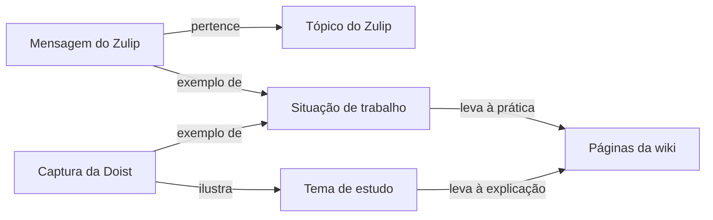

# Explorar o grafo da coleta

O [índice](index.md) reúne as páginas revisadas. O grafo permite partir de uma delas e encontrar outros exemplos na coleta local. Uma mensagem pode estar ligada ao tópico do Zulip, a uma situação como negociação de prazo e a um tema como gramática. Cada captura da Doist preserva o link da publicação, o caminho da imagem e o texto extraído. Para conferir a redação de uma captura, abra a imagem.



## Construir a partir do acervo local

Na raiz do projeto, baixe as fontes que quiser incluir. O coletor maior pode retomar de onde parou. Para extrair texto das capturas elegíveis, tenha o Tesseract com o modelo de inglês `eng` disponível. Use `--tesseract` se ele estiver fora do PATH. [Coleta do projeto](../README.md)

```powershell
python -B baixar_conversas.py
python -B wiki/ocr_doist.py
python -B -X utf8 wiki/construir_grafo.py construir
```

Se a coleta já existir, comece pelo OCR e pela construção. O índice lê a base maior do Zulip, o piloto e os recortes da amostra que estiverem presentes. Cada ID de mensagem entra uma vez. As imagens ausentes ou que ainda precisam de OCR aparecem no resumo. O índice SQLite e a saída do OCR ficam em `dados/`, que o Git ignora.

## Procurar exemplos

```powershell
python -B -X utf8 wiki/construir_grafo.py resumo
python -B -X utf8 wiki/construir_grafo.py buscar --situacao se-apresentar --curados --formato markdown
python -B -X utf8 wiki/construir_grafo.py buscar --situacao negociar-prazo --fonte Doist --limite 10
python -B -X utf8 wiki/construir_grafo.py buscar --tema phrasal-verbs --texto "get back"
python -B -X utf8 wiki/construir_grafo.py mostrar zulip-msg-2552913
```

Os resultados incluem ID e link original. Use `mostrar` para ver o texto e as ligações de um item. Use `--pular 10` para a página seguinte de uma busca limitada a dez itens. No Codex, peça uma busca no grafo e uma prática com o exemplo que você escolher.

O índice usa três relações. `pertence` leva a mensagem ao tópico. `candidato` registra a expressão que acionou uma regra de classificação. `curado` liga às situações e aos temas um exemplo conferido nas páginas. Toda mensagem entra no índice mesmo quando nenhuma regra a classifica. Em [pronúncia](pronuncia.md), os modelos de fala vêm de fontes com áudio.

Ao conferir um novo exemplo, siga as [instruções de manutenção](AGENTS.md) e acrescente seu ID à [curadoria](curadoria.json). Atualize o índice local após incorporar novas fontes ou mudar as regras.
