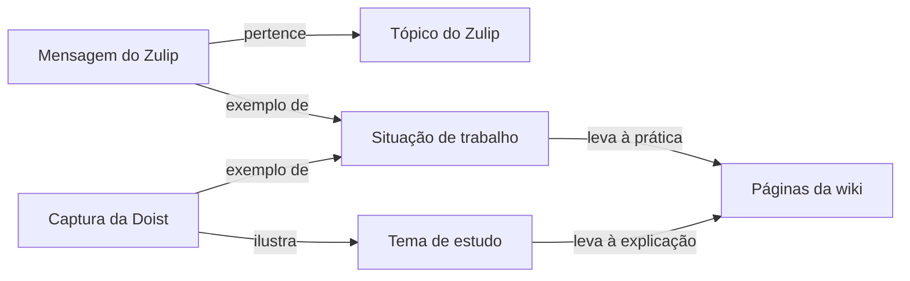

# Explorar o grafo da coleta

O [índice](index.md) reúne as páginas de estudo. Na [edição local](local/index.md), uma mensagem pode estar ligada ao tópico do Zulip, a uma situação como negociação de prazo e a um tema como gramática. A edição de curadoria do repositório inclui as transcrições da Doist e as referências de origem. Os arquivos originais de imagem, de anexo e de exportação ficam na máquina coletora do mantenedor.



## Usar a edição pronta

No plugin, peça um exemplo e abra o ID retornado. Em um clone, execute os comandos na raiz do repositório. O primeiro restaura as páginas de texto e o grafo da edição publicada.

```sh
python -B -m tools.packaging.restore_wiki
python -B -m tools.curation.build_graph summary
python -B -m tools.curation.build_graph search --situation se-apresentar --verified-only --format markdown
python -B -m tools.curation.build_graph search --situation negociar-prazo --source Doist --limit 10
python -B -m tools.curation.build_graph search --topic phrasal-verbs --text "get back"
python -B -m tools.curation.build_graph show zulip-msg-2552913
python -B -m tools.curation.build_wiki --verify
```

Os resultados trazem o ID, a página dentro da wiki e a URL de procedência. Use `show` para ver o texto e as ligações de um item. Para a próxima página de uma busca com dez resultados, use `--offset 10`.

O índice usa três relações. `pertence` leva a mensagem ao tópico. `candidato` registra a expressão que acionou uma regra de classificação. `curado` liga às situações e aos temas um exemplo conferido nas páginas. O YAML usa `learning_uses` para indicar usos pedagógicos da interação. Em tópicos do Zulip, `learning_by_message` acrescenta os usos de mensagens específicas e `message_learning_default` indica `leitura-contextual` para as demais. Em [pronúncia](pronuncia.md), a transcrição e os exercícios estão na página. Os links para áudio são opcionais.

## Decisões por ID

A busca `search_wiki` consulta o texto das páginas e os vínculos do grafo. Use `kind`, `source`, `topic`, `situation`, `text`, `function` e `curation` para selecionar resultados. Com `curation: conferido`, confira a função e o trecho em `evidencias`. Abra `citar_id` com `read_wiki_item` e use `offset_texto` quando o trecho estiver adiante no texto. Um anexo indica as mensagens de origem na lista `origens`. A fonte `Projeto` identifica os guias e as adaptações escritos para o estudo.

| Situação | Exemplos por função |
| --- | --- |
| Pedir atualização | [Perguntar pelo andamento](local/zulip/canal-137/zulip-topico-8d11987ce5198a1a3dcbe657.md#zulip-msg-1021504) · [pedir notícias de uma tarefa](local/doist/doist-pedir-atualizacao.md) |
| Negociar prazo | [Pedir mais tempo](local/zulip/canal-127/zulip-topico-617d08ae9ea45953393575c8.md#zulip-msg-413776) · [propor outra data](local/doist/doist-combinar-prazo.md) · [recusar o prazo](local/zulip/canal-9/zulip-topico-525ecba640cdf78698db13bf.md#zulip-msg-1236079) · [confirmar a extensão](local/zulip/canal-127/zulip-topico-617d08ae9ea45953393575c8.md#zulip-msg-413787) |
| Dar feedback | [Sugerir uma introdução para o leitor](local/doist/doist-dar-feedback.md) · [recomendar um exemplo mais específico](local/zulip/canal-92/zulip-topico-33be18bcf012f09cdb77b444.md#zulip-msg-168107) |
| Confirmar próximos passos | [Assumir uma tarefa](local/zulip/canal-378/zulip-topico-c71e9f563b5a009382da8b3e.md#zulip-msg-2499678) · [prometer retorno](local/zulip/canal-137/zulip-topico-32aa081248d947f4eb291f7a.md#zulip-msg-1950081) |
| Apresentar-se | [Apresentar o papel](local/doist/doist-learning-ally-recepcao-voluntarios.md) · [descrever a experiência](local/zulip/canal-2/zulip-topico-2ada5702e199cf63c9129129.md#zulip-msg-2552913) |
| Pedir ajuda | [Pedir orientação](local/anexos/zulip-anexo-0d1d5afcd4c82604931d79ec8832512a.md) · [solicitar um teste](local/zulip/canal-43/zulip-topico-d8db24549f1af78a3ebd3b4a.md#zulip-msg-535380) |
| Esclarecer | [Conferir a interpretação](local/zulip/canal-101/zulip-topico-593360455d5a9540bc2c1502.md#zulip-msg-2535843) · [confirmar o sentido de uma palavra](local/zulip/canal-92/zulip-topico-33be18bcf012f09cdb77b444.md#zulip-msg-168127) |
| Comunicar risco | [Explicar a condição de risco](local/zulip/canal-3/zulip-topico-3bddea53f8ad3a38257c0a0a.md#zulip-msg-1327548) · [alertar sobre o impacto](local/zulip/canal-101/zulip-topico-61ded17f89c1d3e75bf5160c.md#zulip-msg-2531120) |

O [registro de decisões](decisoes.tsv.gz) usa uma linha por item com ID, tipo, assinatura do material, estado e motivo ou função. Os trechos conferidos e seus usos estão em [curadoria.json](curadoria.json). O preparo restaura a edição e incorpora os registros ao grafo de consulta em `local/consulta.sqlite3`. O leitor do grafo combina essa base com `local/grafo.sqlite3`. As páginas originais guardam as transcrições.

A busca atualiza as páginas que mudaram e exclui as removidas. Uma mudança no texto ou no contexto relevante deixa a decisão pendente de avaliação. A qualidade da transcrição aparece em um campo próprio.

Na raiz do projeto, execute `python -B -m tools.curation.review_items` para comparar os IDs com o grafo, os catálogos e as páginas. Consulte `search_wiki` com `curation: pendente` para retomar a leitura. Para listar um lote por ID, execute `python -B -m tools.curation.review_items --pending mensagem --limit 50`. A próxima página aceita `--after ID` com o último ID exibido. Cada situação conta o mesmo ID uma vez.

Abra o ID e confira o texto e o contexto da página. Registre a decisão em um lote JSONL, uma linha por item com `id`, `tipo`, `assinatura`, `estado` e `motivo`. Use `apoio` com a função do material, ou `sem-uso` com o motivo. Para `conferido`, inclua `evidencias` com o trecho literal, a função em `funcao` e a lista de `usos` de cada exemplo. A assinatura vem de `read_wiki_item`.

Execute `python -B -m tools.curation.review_items --record --reviews lote.jsonl` para incorporar o lote aos registros da wiki. A importação verifica o ID, a assinatura e os trechos antes de gravar. Os IDs que ainda precisam de leitura continuam pendentes. O preparo de um clone restaura os registros publicados. Execute `python -B -X utf8 tests/check_wiki_mcp.py` para repetir os testes no MCP com um caderno temporário.

## Anexos do Zulip

O [índice de anexos](local/anexos/index.md) abre o texto extraído dos arquivos. Cada página liga às mensagens que citaram o anexo, e essas mensagens ligam de volta à página. No YAML, `learning_from_text` indica sinais no texto extraído e `learning_from_context` indica sinais nas mensagens. O texto fica na própria wiki, pronto para leitura offline.

O registro guarda o nome do arquivo, os vínculos com as mensagens e o texto disponível. A seção `Content` contém o trecho transcrito. Quando a frase está apenas na mensagem de origem, abra a mensagem e cite o ID dela. Consulte o [registro de extração](local/anexos/extracao.json) para ver o método, a qualidade e as notas de revisão. O campo `manual_review: true` indica uma revisão manual.

### Revisão visual do OCR

A revisão visual em massa e o OCR estão pausados. Na curadoria, cite apenas palavras legíveis na transcrição publicada. Use a qualidade registrada para explicar uma lacuna de leitura. A consulta aos arquivos originais ocorre na máquina coletora.

## Reconstruir a edição quando a coleta mudar

O mantenedor prepara a edição em texto na máquina coletora. A distribuição inclui as mensagens, as transcrições, os registros de anexos e o grafo. Os links das publicações preservam a procedência. Para rever um exemplo em um clone, restaure a edição publicada e siga o procedimento por ID acima. Os rótulos do catálogo da Doist estão em [sinais-doist.json](sinais-doist.json). [Manutenção da wiki](AGENTS.md)
