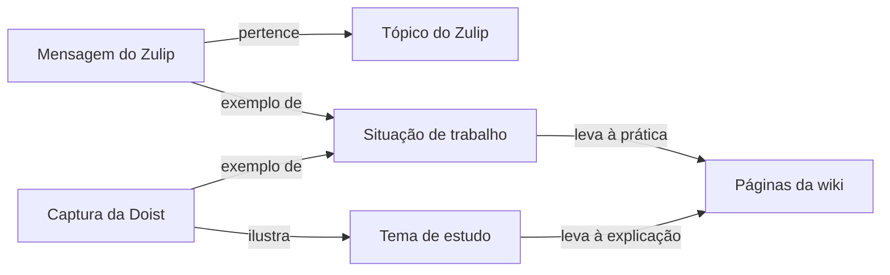

# Explorar o grafo da coleta

O [índice](index.md) reúne as páginas de estudo. Na [edição local](local/index.md), uma mensagem pode estar ligada ao tópico do Zulip, a uma situação como negociação de prazo e a um tema como gramática. A edição de curadoria do repositório inclui as transcrições da Doist e as referências de origem. Na máquina da coleta também há imagens para conferência visual.



## Usar a edição pronta

Copie a pasta `wiki/` inteira, incluindo `local/`. Abra `index.md` no destino. Na pasta copiada, você também pode usar o grafo SQLite incluído nela:

```powershell
python -B -X utf8 construir_grafo.py resumo
python -B -X utf8 construir_grafo.py buscar --situacao se-apresentar --curados --formato markdown
python -B -X utf8 construir_grafo.py buscar --situacao negociar-prazo --fonte Doist --limite 10
python -B -X utf8 construir_grafo.py buscar --tema phrasal-verbs --texto "get back"
python -B -X utf8 construir_grafo.py mostrar zulip-msg-2552913
python -B -X utf8 ingerir_acervo.py --verificar
```

Os resultados trazem o ID, a página dentro da wiki e a URL de procedência. Use `mostrar` para ver o texto e as ligações de um item, ou `--pular 10` para navegar à página seguinte de uma busca com dez resultados.

O índice usa três relações. `pertence` leva a mensagem ao tópico. `candidato` registra a expressão que acionou uma regra de classificação. `curado` liga às situações e aos temas um exemplo conferido nas páginas. O YAML usa `learning_uses` para indicar usos pedagógicos da interação. Em tópicos do Zulip, `learning_by_message` acrescenta os usos de mensagens específicas e `message_learning_default` indica `leitura-contextual` para as demais. Em [pronúncia](pronuncia.md), a transcrição e os exercícios estão na página. Os links para áudio são opcionais.

## Anexos do Zulip

O [índice de anexos](local/anexos/index.md) abre o texto extraído dos arquivos. Cada página liga às mensagens que citaram o anexo, e essas mensagens ligam de volta à página. No YAML, `learning_from_text` indica sinais no texto extraído e `learning_from_context` indica sinais nas mensagens. O texto fica na própria wiki, pronto para leitura offline.

Na raiz do projeto, rode `python -B -X utf8 wiki/processar_anexos.py` para baixar os anexos com acesso anônimo, extrair o texto e atualizar a edição local. Rode o mesmo comando para retomar. Use `--resumo` para ver a contagem sem rede ou `--so-transcrever` para concluir a transcrição e depois incorporá-la com `python -B -X utf8 wiki/ingerir_anexos.py`. Os arquivos baixados ficam na pasta da coleta.

O OCR usa Tesseract com o modelo `eng`. Para PDFs, instale PyMuPDF ou Poppler. Para vídeo e áudio, disponibilize FFmpeg e FFprobe. Passe `--modelo CAMINHO` com um modelo Whisper local para transcrever fala, e acrescente `--dispositivo cuda` se o ambiente tiver suporte. Em vídeo, o OCR usa quadros amostrados.

Cada anexo com texto tem uma seção `Content`. A página indica quando a transcrição é parcial. Para conferir o método, o estado ou as notas de revisão, procure o ID do anexo no [registro de extração](local/anexos/extracao.json). Uma revisão manual tem `manual_review: true` nesse registro. A reconstrução reaplica as revisões de `dados/zulip/anexos/revisoes-manuais.json` quando o ID e o SHA-256 correspondem ao arquivo coletado.

### Revisão visual do OCR

A revisão com Terra médio usa as imagens originais da Doist e do Zulip. Em vídeos e animações, os lotes usam os quadros selecionados para OCR. PDFs e arquivos ZIP podem ter várias imagens por arquivo. Cada transcrição conferida fica em `dados/revisao-ocr/terra/`, identificada pelo ID e pelo SHA-256 do original. A página preserva o idioma, a grafia e a pontuação da imagem. A indicação de transcrição parcial cobre, por exemplo, uma linha cortada ou encoberta.

Na raiz do projeto, use `python -B -X utf8 wiki/revisar_ocr.py resumo` para ver quantos arquivos já têm revisão e quantos já chegaram à wiki. Para retomar uma fila interrompida, rode `wiki/revisar_ocr.py revisar --executavel CAMINHO` com Python e o executável do Codex Desktop que oferece Terra. Uma execução retoma pelos recibos existentes e publica os próximos lotes. A gravação mantém o OCR bruto para comparação.

## Reconstruir a edição quando a coleta mudar

Na raiz do projeto de coleta, use o Tesseract com o modelo de inglês `eng`. A coleta pode retomar de onde parou. Pule a coleta e o OCR se já tiver os arquivos locais.

```powershell
python -B baixar_conversas.py
python -B wiki/ocr_doist.py
python -B -X utf8 wiki/construir_grafo.py construir
python -B -X utf8 wiki/ingerir_acervo.py
```

O construtor combina a coleta maior, o piloto e a amostra por ID. O materializador cria Markdown por tópico, preserva as mensagens completas, copia as imagens e inclui o grafo em `wiki/local/`. Para incorporar só novos exemplos conferidos, atualize a [curadoria](curadoria.json), rode `construir_grafo.py atualizar-curadoria` no projeto e gere a edição de novo. Os rótulos baseados no OCR e no catálogo da Doist estão em [sinais-doist.json](sinais-doist.json). [Manutenção da wiki](AGENTS.md)
